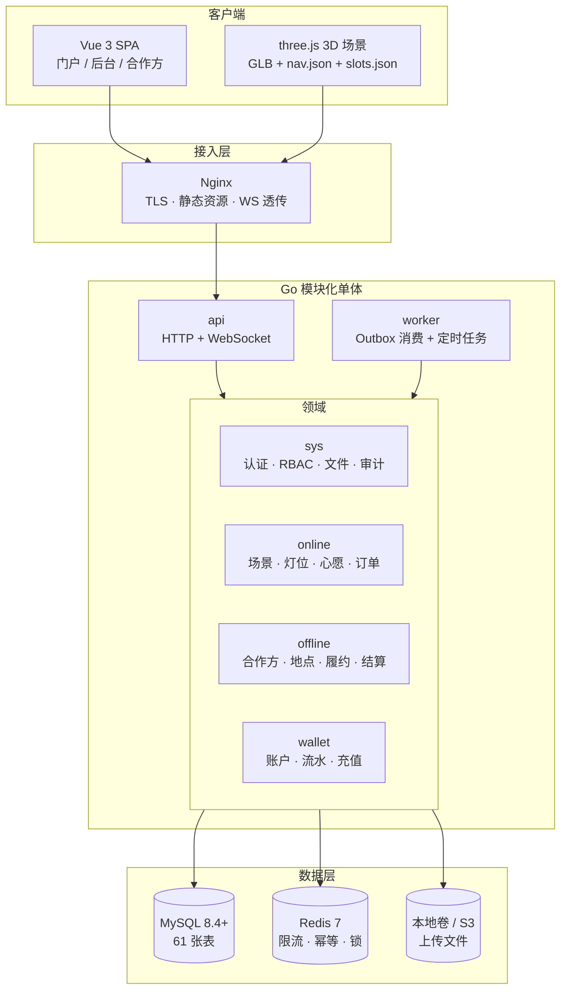

# WishSpace
**线上数字供灯 + 线下寺院/宫庙供灯履约** 一体化平台。C 端可以在可漫游的 3D 寺院里点灯许愿，也可以预约真实地点的供灯服务；平台侧提供内容审核、派单履约、凭证审核、退款投诉、财务结算与虚拟货币的完整运营闭环。
# WishSpace · 心愿里

> 让每一份心愿，都有一个温暖的地方。

**线上数字供灯 + 线下寺院/宫庙供灯履约** 一体化平台。C 端可以在可漫游的 3D 寺院里点灯许愿，也可以预约真实地点的供灯服务；平台侧提供内容审核、派单履约、凭证审核、退款投诉、财务结算与虚拟货币的完整运营闭环。

[功能说明](docs/FEATURES.md) · [编译指南](docs/BUILD.md) · [部署手册](docs/INSTALL.md) · [接口契约](docs/openapi.yaml) · [数据库设计](docs/DATABASE.md)


---

## 界面预览

| 3D 点灯场景 | 首页 |
|---|---|
|  |  |

| 心愿墙 | 线下道场 |
|---|---|
|  |  |

| 我的福缘（充值） | 运营看板 |
|---|---|
|  |  |

---

## 核心能力

### 线上：可走进去的 3D 灯院

- **五院场景**：中院大雄宝殿、前院、东院观音殿、西院地藏殿、塔院石塔与藏经阁，可行走约 1074 ㎡
- **第三人称漫游**：键鼠/触屏移动，滚轮缩放与转向分离，相机跟随并做遮挡回缩，不穿墙
- **殿宇可进入**：四座殿从明间走入拜佛，台基与踏跺是可站立面，角色逐级抬升
- **180 个灯位**：点亮后灯盏真实发光并抬升到层板上方；点灯时写心愿（公开/私密/匿名），灯上只显示会员昵称，称谓与心愿仅灯主可见
- **点灯用金币**：灯型价目与支付页只出现后台配置的币名（默认「福缘」），人民币只在充值页
- **每日签到**：一天一次、奖励 1 个金币，3D 场景顶栏「签」与「我的」页都能签，连续天数与本月日历同步
- **在场感**：WebSocket 同步同场景其他用户的昵称、造型、位置与动作；游客也有匿名身份
- **环境音与背景乐**：夜风、细雨、远处钟声 + 空灵静谧的五声拨弦，全部 Web Audio 现场合成，零音频素材
- **三档画质 + 自动降档**，无 WebGL 时降级 2D 网格，功能不中断

### 线下：可履约的供灯服务

- 地点 / 服务 / 价格 / 排班 / 容量全配置化，**下单锁量，不超卖**
- 合作方接单 → 到场 → 上传凭证 → 平台审核 → 完成结算
- 14 状态订单状态机，非法跃迁一律 409，每次迁移留痕可回放
- 退款、投诉、结算、对账完整闭环

### 交易与资金

- 金额全链路以**分**为整数，ID 用雪花字符串，避免精度问题
- `Idempotency-Key` + 唯一键 + 状态机三层幂等闸门
- 内置虚拟货币「福缘」：后台可改名/改汇率，充值最低 5 元
- 充值支持 **上传收款码 / 支付宝 / 微信支付 / 沙箱**，后台四选一，密钥加密存储
- 金币可直接全额抵扣线上/线下订单，扣币与落账失败自动退回

### 运营后台

17 个菜单：数据看板、心愿审核、场景与 3D、合作方管理、道场管理、服务与价格、订单管理、任务履约、凭证审核、退款处理、投诉处理、结算管理、用户与权限、举报处理、充值管理、金币设置、系统设置。灯型、活动、审计等作为子页挂在对应模块下。

RBAC + 数据范围双控：`location_admin` 只看授权地点，`provider_admin` 只看本合作方，越权在 SQL 层收口。

---

## 技术架构



**设计约束**

| 约束 | 做法 |
|---|---|
| 领域分治 | `sys` / `online` / `offline` / `wallet` 四域，跨域只经接口与事件，不直接读对方表 |
| 无物理外键 | 域间用逻辑外键，避免跨域级联与分库障碍 |
| 异步不丢 | Outbox 表 + worker 消费，支付成功→建任务→自动派单可靠落地 |
| 可多实例 | `NODE_ID` 区分雪花节点；定时任务用 KV 锁互斥 |
| 可降级 | 无 Redis 退化为进程内 KV；无 WebGL 退化 2D；模型 404 保留简化场景 |

---

## 快速开始

### 方式一：Docker Compose（推荐）

```bash
cp .env.example .env          # 按需修改密码与密钥
docker compose up -d --build
docker compose ps             # 等 api 变为 healthy
```

启动顺序由编排保证：MySQL/Redis 健康 → `migrate` → `seed` → `api` → `worker` → `web`。

| 服务 | 地址 |
|---|---|
| 前端 | http://127.0.0.1:8000 |
| API | http://127.0.0.1:8080/api/v1 |
| 健康检查 | http://127.0.0.1:8080/healthz · `/readyz` |
| MySQL | 127.0.0.1:3306 |
| Redis | 127.0.0.1:6379 |

需要 S3 兼容存储：`docker compose --profile s3 up -d minio`，并把 `STORAGE_DRIVER` 改为 `s3`。

### 方式二：本地开发

```bash
make deps                 # go mod download + npm ci
make env                  # 生成 .env
set -a; source .env; set +a   # 后端不自动读 .env，每个新终端导出一次

make migrate-up           # 建表
make seed                 # 权限/角色/账号/样例数据

make api                  # :8080
make worker               # 后台任务（另一个终端）
make web                  # :5173（另一个终端）
```

后端不在 8080 时，前端指定代理目标：

```bash
VITE_PROXY_TARGET=http://127.0.0.1:18080 npm run dev --prefix frontend
```

> 完整的环境变量、工具链版本、3D 资产生成与故障排查见 [docs/BUILD.md](docs/BUILD.md)。

### 默认账号

种子执行后可用（**生产环境请立刻改密**）：

| 角色 | 账号 | 入口 |
|---|---|---|
| 平台管理员 | `admin@dev.local` | `/admin/login` |
| C 端用户 | `user@dev.local` | `/login` |
| 合作方 / 执行人 | `providerA@dev.local` / `executor@dev.local` | `/provider/login` |

统一密码：`Dev@12345`。完整 7 个账号见 [docs/TEST-ACCOUNTS.md](docs/TEST-ACCOUNTS.md)。

---

## 项目结构

```
.
├── backend/
│   ├── cmd/                 # api | worker | migrate | seed | smoke | loadtest | legal
│   ├── internal/
│   │   ├── config/          # 环境变量装载与生产强校验
│   │   ├── router/          # 路由聚合、健康检查、限流
│   │   ├── domain/          # sys | online | offline | wallet
│   │   └── pkg/             # types/idgen/authx/idem/event/storage/pay/mw/secure…
│   ├── migrations/          # 按域分目录的 SQL 迁移（go:embed）
│   └── static/scene/        # GLB、灯位坐标、导航数据
├── frontend/
│   ├── src/{api,components,views,stores,router}
│   └── scripts/             # 场景与人物 GLB 生成器
├── deploy/                  # 生产加固覆盖层（TLS/账号/自检/回滚）
├── docs/                    # 文档与接口契约
├── docker-compose.yml
└── Makefile
```

---

## 接口约定

```json
{ "code": 0, "message": "ok", "data": {}, "request_id": "..." }
```

- `code = 0` 成功；`4xxxx` 客户端错误，`5xxxx` 服务端错误，HTTP 状态码同步
- 分页：`{ "list": [], "total": 0, "page": 1, "page_size": 20 }`
- 认证：`Authorization: Bearer <access_token>`，401 自动刷新并重试一次
- 幂等：写请求可带 `Idempotency-Key`，重复请求回放首次响应（4xx 不缓存）
- 金额：以**分**为单位的字符串，如 `"12800"` = 128.00 元
- ID：雪花 ID 字符串

全量契约见 [docs/openapi.yaml](docs/openapi.yaml)。

---

## 测试与质量

```bash
make check      # go vet + go build + vue-tsc
make test       # 后端单测
make smoke      # 56 步端到端（需 api + worker，建议 RATE_LOGIN=120）
make loadtest   # 100 并发下单 + 100 QPS 回调
```

CI（GitHub Actions）覆盖：格式检查、`go vet`、编译全部命令、跑迁移与种子、`go test -race`、前端类型检查与构建、镜像构建、compose 配置校验。

质量记录：[测试报告](docs/TEST-REPORT.md) · [安全测试](docs/SECURITY.md) · [压测](docs/LOAD-TEST.md) · [3D 性能](docs/PERF-3D.md)

---

## 文档索引

| 文档 | 内容 |
|---|---|
| [功能说明](docs/FEATURES.md) | 三端功能矩阵、主流程、状态机、权限、已知限制 |
| [源码编译与环境搭建](docs/BUILD.md) | 工具链、依赖、编译、迁移种子、启动、测试、故障排查 |
| [架设与部署](docs/INSTALL.md) | 服务器准备、Compose/裸机、TLS、支付配置、备份、升级回滚 |
| [部署手册](docs/DEPLOY.md) | 部署细节与生产加固 |
| [运维手册](docs/RUNBOOK.md) | 定时任务、告警处置、常见故障、备份恢复 |
| [运营 SOP](docs/OPS-SOP.md) | 审核、退款、停服、投诉、结算话术 |
| [数据库设计](docs/DATABASE.md) | 61 张表、逻辑外键、全量字段字典 |
| [金币与充值](docs/WALLET.md) | 币名/汇率、四种收款方式、幂等与密钥安全 |
| [3D 场景技术](docs/3D-SCENE.md) | 资产、导航碰撞、相机、造像、性能与降级 |
| [3D 扩图计划](docs/MAP-EXPANSION-PLAN.md) | 单庭院 → 五院的改造过程与踩坑 |
| [测试账号](docs/TEST-ACCOUNTS.md) | 测试地址、7 个账号、全站页面路径、测试动线 |
| [上线检查表](docs/GO-LIVE-CHECKLIST.md) | G0–G4 五道闸门逐项可勾选 |
| [公众号文案](docs/PROMO-WECHAT.md) | 已成稿的公众号文章，含标题/摘要/封面/正文，可直接发布 |
| [接口契约](docs/openapi.yaml) | OpenAPI 3.0 |

---

## 路线图

- [ ] 金币 + 现金混合支付
- [ ] 金币支付订单自动退币
- [ ] 微信小程序端与公众号模板消息
- [ ] 正式美术资产替换（LOD + 分块加载）
- [ ] 多语言（i18n）
- [ ] 合作方移动端工作台

---

## 贡献

1. Fork 并新建分支：`feat/xxx` / `fix/xxx`
2. 提交前跑 `make check && make test`
3. 涉及迁移的改动，同时提交 `up.sql` 与 `down.sql`
4. PR 描述写清「改了什么、为什么、怎么验证」

---

## 许可证

本项目暂未指定开源许可证（All rights reserved）。如需对外开源，请补充 `LICENSE` 文件并在本节更新说明。

第三方依赖遵循各自许可证，主要包括 Gin、GORM、three.js、Vue、Element Plus 等。
